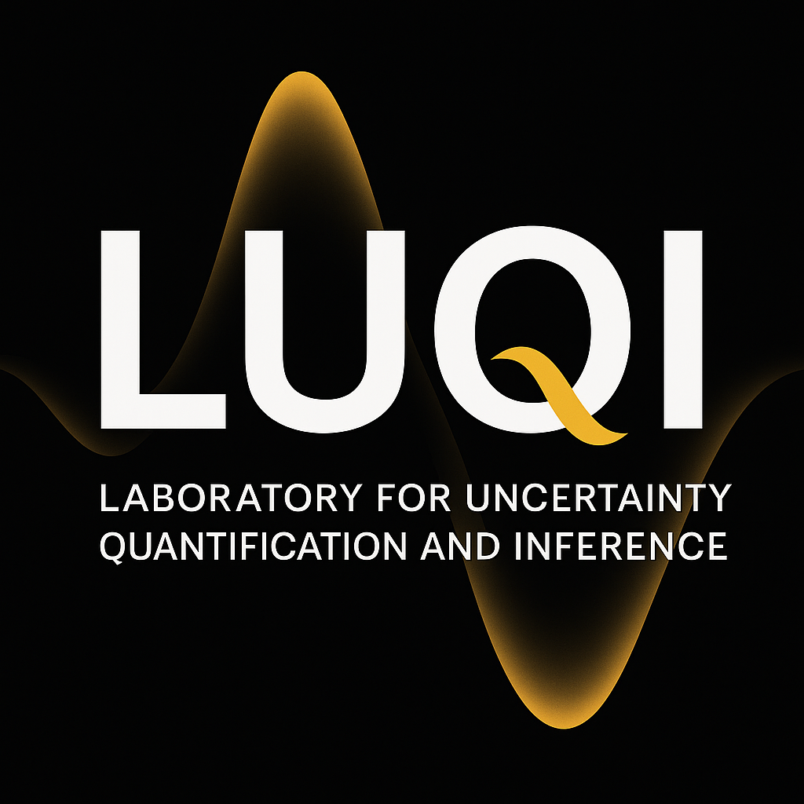

```{=html}

```

::: {.home-meta}
[Laboratory for Uncertainty Quantification and Inference]{.site-role}

Department of Computer Science<br>
University of Central Florida<br>
Orlando, FL, USA

[[SPRK 212](https://maps.app.goo.gl/sQDSjpikukU6ykPo9)] &ensp; [[GitHub](https://github.com/luqigroup)]
:::

<!-- <div style="
  display: flex;
  justify-content: center;
  text-align: center;
  margin: 10px 0; /* Adds vertical spacing without excessive whitespace */
">
  <span style="
    background-color: #fdfbd3;
    color: #373a3c;
    border: 1px solid #727475;
    padding: 6px;
    border-radius: 5px;
    display: inline-block;
    max-width: 100%;
    word-wrap: break-word;
    text-align: center;
  ">
    <strong>Reach out to [Ali Siahkoohi](http://alisiahkoohi.github.io/) if interested to join the LUQI group!</strong>
  </span>
</div> -->
